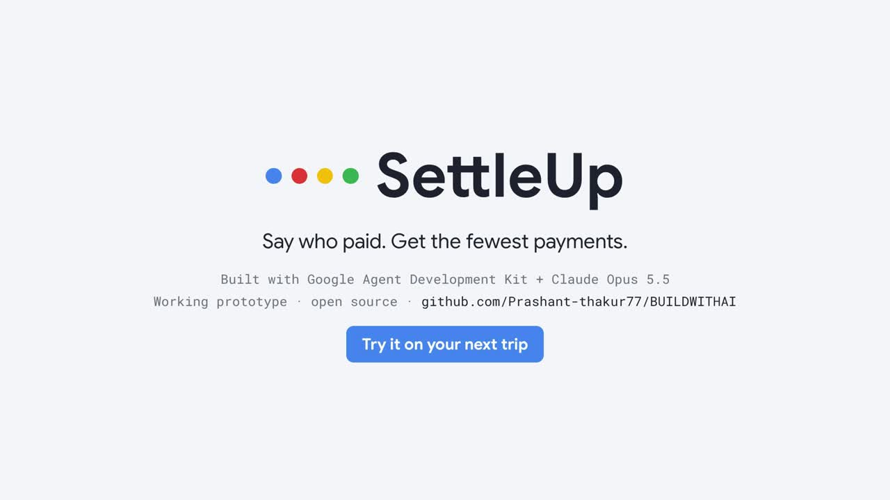
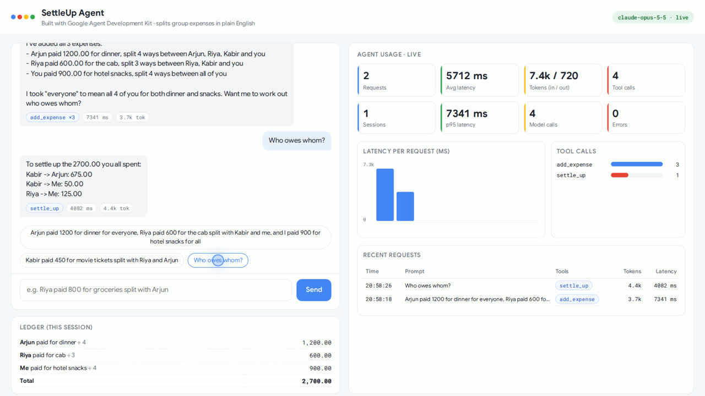
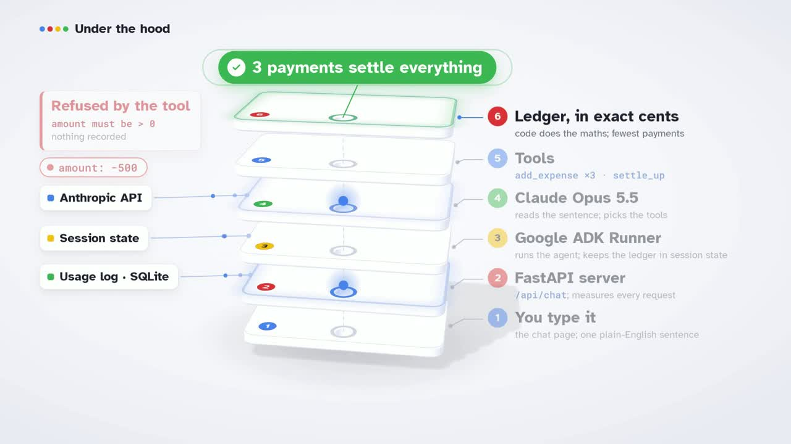
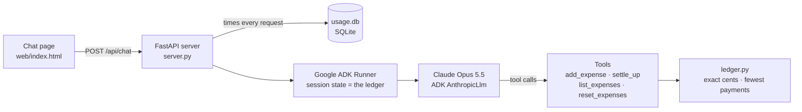

# SettleUp

**Say who paid, in plain English. Get the fewest payments that settle everyone.**

SettleUp is a small AI agent built with Google's [Agent Development Kit (ADK)](https://google.github.io/adk-docs/) and
Claude. You describe a trip, a dinner or a month of flat bills the way you would text a friend. The agent records
every expense with tools, and plain Python works out who owes whom in exact cents. A live dashboard shows what every
request cost.

[](docs/SettleUp-film-720p.mp4)

▶ **[Watch the demo film (2:10)](docs/SettleUp-film-720p.mp4)** · captions: [SettleUp-film.srt](docs/SettleUp-film.srt)

---

## The problem

It's the last night of a trip. Four friends, one group chat, and a pile of bills. Who paid for dinner? Who owes for
the cab? Is it 675, or 725? Most expense apps want a form for every bill. And the friend who paid the most is usually
the one who has to ask.

## What it does

```text
You:   Arjun paid 1200 for dinner for everyone, Riya paid 600 for the cab split with Kabir and me,
       and I paid 900 for hotel snacks for all
Agent: Logged 3 expenses.                                         (add_expense ×3)

You:   Who owes whom?
Agent: To settle up the 2700.00 you all spent:                    (settle_up)
       Kabir -> Arjun: 675.00
       Kabir -> Me: 50.00
       Riya -> Me: 125.00
```

That is real output from Claude Opus 5.5, recorded in the demo film.



- **One sentence, many expenses.** "Split with X and Y", "for everyone" and "I paid" are all understood. The agent
  calls `add_expense` once per expense.
- **The model never does arithmetic.** Claude only reads the words and picks the tools. `ledger.py` does the maths
  in integer cents and spreads leftover cents fairly.
- **The fewest payments.** A greedy largest-creditor / largest-debtor match: a group of *n* people never needs more
  than *n − 1* payments.
- **Bad input is refused by the tool.** An amount of 0 or less, or an expense with no participants, is rejected
  before anything is recorded.
- **Usage you can see.** Every request is logged: latency (average and p95), input and output tokens, model calls,
  tool calls and errors, plus a latency chart and a request log.

## How it works





| Path | What it is |
|---|---|
| [`settle_agent/agent.py`](settle_agent/agent.py) | The ADK `Agent` (`root_agent`), its instruction and its four tools. Expenses live in ADK session state. |
| [`settle_agent/ledger.py`](settle_agent/ledger.py) | Balances and the minimum-payment settlement, in integer cents. |
| [`settle_agent/offline_model.py`](settle_agent/offline_model.py) | A rule-based `BaseLlm` that runs only when no API key is set, so the app works end to end offline. |
| [`server.py`](server.py) | FastAPI app. Runs the agent through ADK's `InMemoryRunner` and logs usage per request to SQLite. |
| [`web/index.html`](web/index.html) | The website: chat and ledger, plus the live usage dashboard. |
| [`tests/`](tests/test_settle.py) | Ledger maths, parsing, and the full chat loop through the API. |
| [`video/`](video/README.md) | The demo film, rebuilt entirely from code (see below). |

## Run it

```bash
git clone https://github.com/Prashant-thakur77/BUILDWITHAI.git && cd BUILDWITHAI
uv venv .venv -p 3.11 && uv pip install --python .venv/bin/python -r requirements.txt
echo 'ANTHROPIC_API_KEY=your-key' > .env      # or GOOGLE_API_KEY=... for Gemini, or nothing for offline mode
.venv/bin/uvicorn server:app --port 8765     # then open http://127.0.0.1:8765
```

| Setting (`.env`) | Effect |
|---|---|
| `ANTHROPIC_API_KEY` | Uses `claude-opus-5-5` at low effort through ADK's `AnthropicLlm` (the official `anthropic` SDK). |
| `GOOGLE_API_KEY` | Uses `gemini-3.5-flash` when no Anthropic key is set. |
| *(no key)* | The offline stand-in runs. The header says `offline-demo (no API key)` and token counts are estimates. |
| `SETTLE_MODEL`, `SETTLE_EFFORT` | Override the model (for example `claude-haiku-5-5` for faster replies) and Claude's effort level. |

- **ADK's own dev UI:** run `.venv/bin/adk web` in this folder and pick `settle_agent`.
- **Tests:** `.venv/bin/python -m pytest -q`. With a key set, the last test calls the live model.

## The demo film

The film is built from code in [`video/`](video/README.md), so changing one line of narration means re-running a
command, not re-editing a timeline.

- **Real footage:** Playwright drives the live app through Chrome's screencast.
- **Real numbers:** `facts.py` reads every number from that run and the tests, and fails if the agent's payments
  ever disagree with `ledger.py`.
- **Voice:** Chatterbox's built-in voice; for each line, Whisper picks the best of three takes.
- **Music and sound:** an original piano theme composed in code, and synthesised sound effects.
- **3D:** a three.js "Under the hood" scene.
- **Captions:** word-by-word karaoke captions.
- **Mix:** a two-pass loudness mix at −14 LUFS.

[storyboard.md](video/storyboard.md) has the beat-by-beat plan, and [LICENSES.md](video/LICENSES.md) lists what
everything is made of.

## Honest limits

- **Speed:** on Claude Opus 5.5 the first reply took 7.3 s and the settle-up 4.1 s (shown in the film's dashboard).
  Speed is the next thing to fix. A smaller model (`SETTLE_MODEL=claude-haiku-5-5`) is the first thing to try.
- **Even splits only:** custom shares and percentages are not supported yet.
- **Storage:** sessions are in memory, so restarting the server clears the ledgers. Only the usage log persists.
- **Local only:** it runs on your machine; there is no hosted demo yet.

## Built with

[Google Agent Development Kit](https://google.github.io/adk-docs/) · [Claude](https://www.anthropic.com/claude) (Opus 5.5) ·
FastAPI · SQLite · Playwright · three.js · Chatterbox TTS · faster-whisper · ffmpeg
